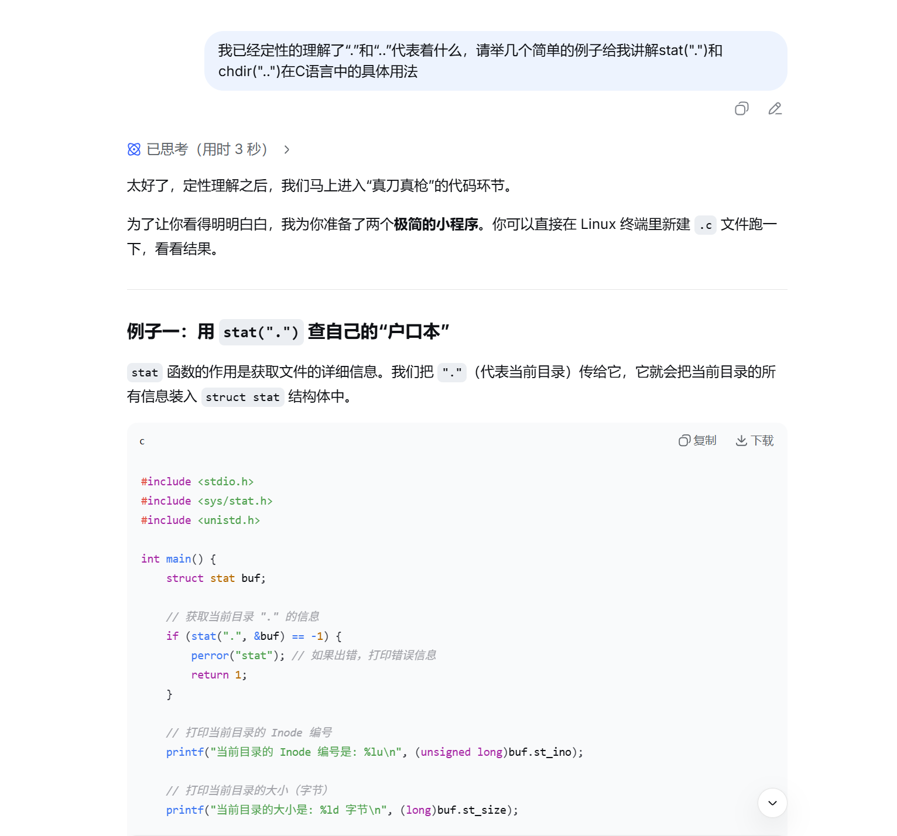
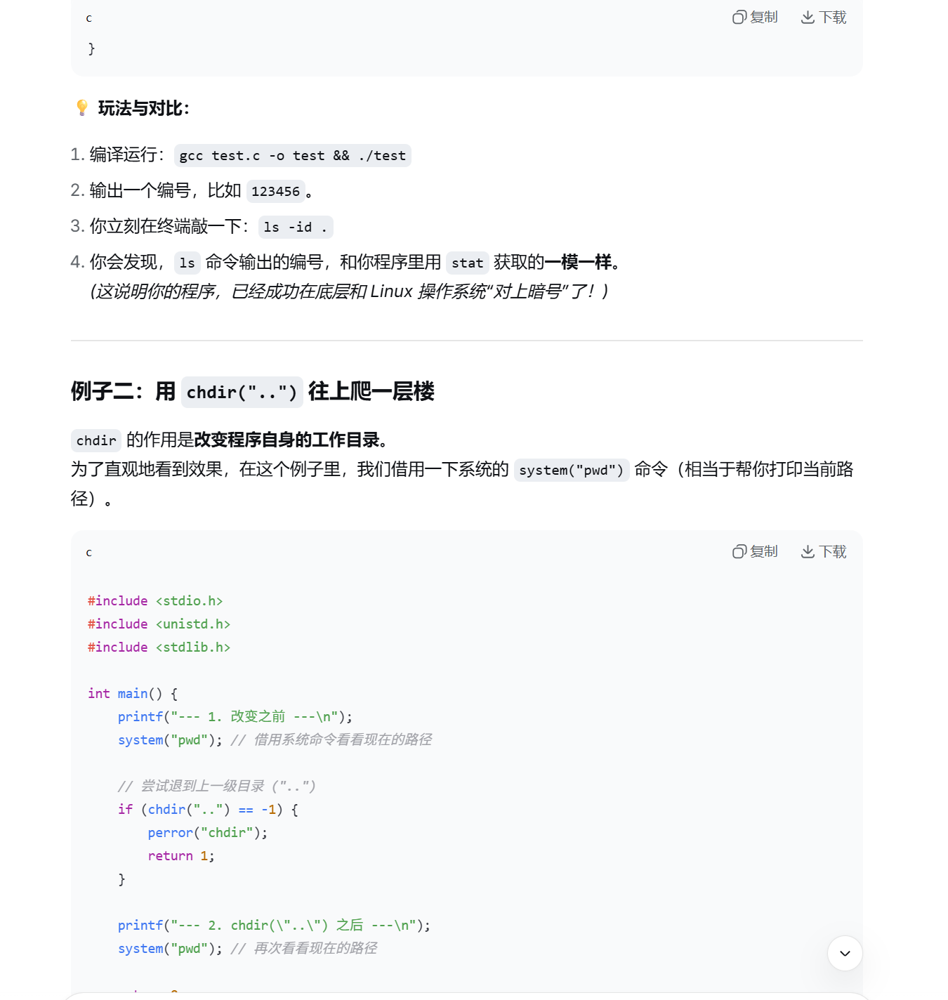
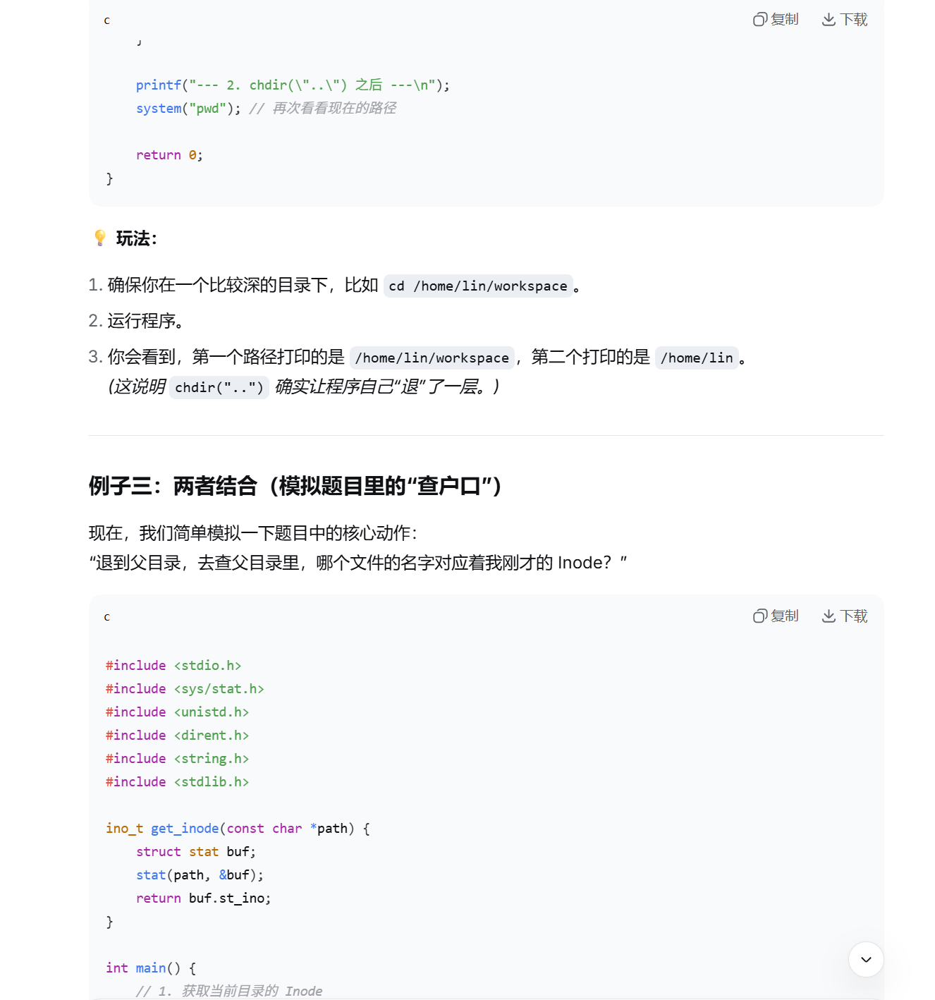
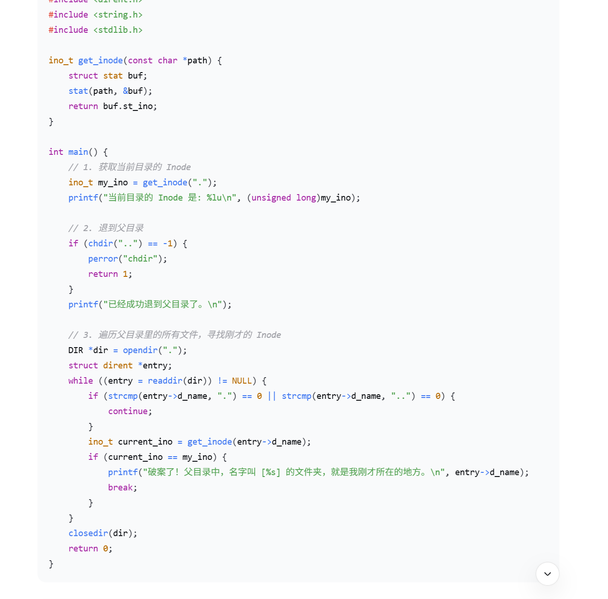
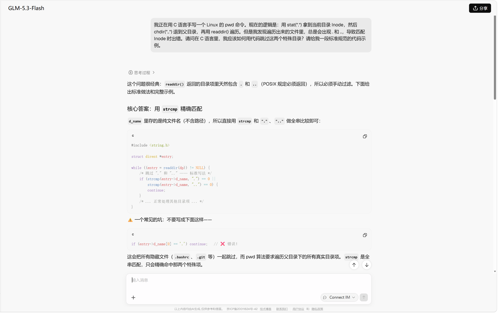
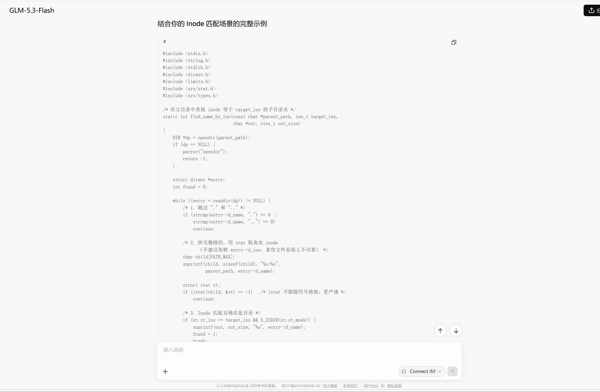
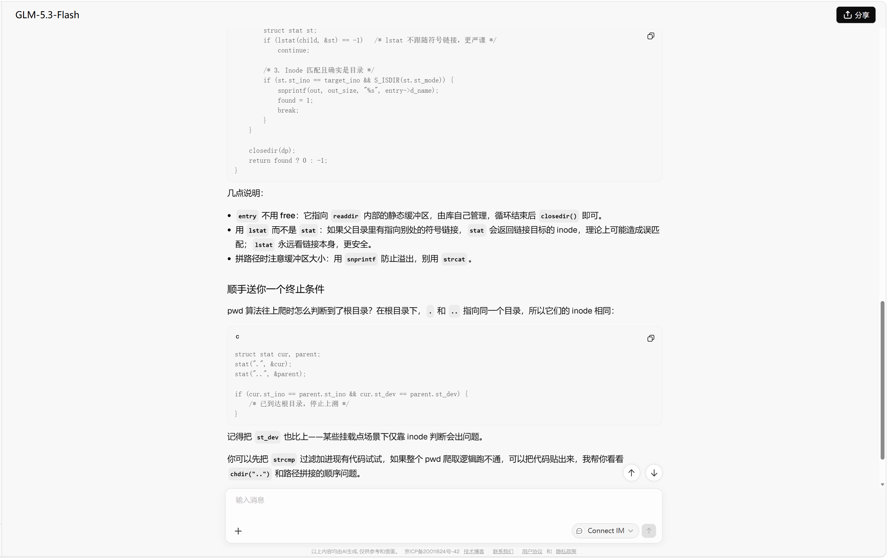
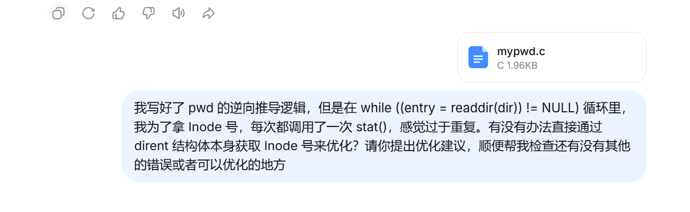
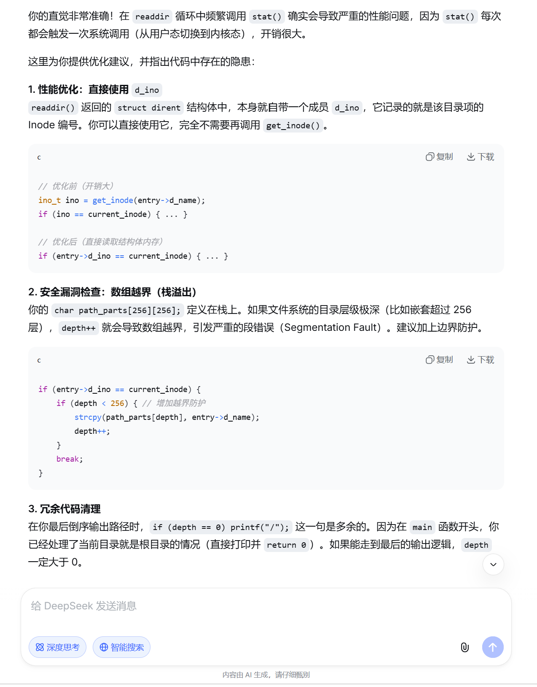

# 第一境：算者 —— 命令行参数与路径

## 任务 1.1：不同的路

* Q1：什么是绝对路径，什么是相对路径？
* A1：
    *   **绝对路径**：总是从系统的根目录（在 Linux 中表示为 `/`）开始写起，一路指向目标文件或目录的完整路径。它就像是完整的快递地址，无论你当前身处系统的哪个位置，使用绝对路径都能准确找到目标。
    *   **相对路径**：是从当前所在的工作目录开始计算的路径。它不使用开头的 `/`，而是利用 `.`（当前目录）、`..`（上一级目录）或直接写子目录名来定位目标。一旦你切换了当前工作目录，相对路径所指向的位置也会发生变化。

* Q2：从 `/home/lin/workspace/` 前往 `/var/backups/turing/` 的命令
* A2：
    * **使用绝对路径的命令：**
    ```bash
    cd /var/backups/turing/
    ```
    * **使用相对路径的命令：**
    ```bash
    cd ../../../var/backups/turing/
    ```

## 任务 1.2：何处启程

* Q1：主函数参数 `argc` 与 `argv[]` 的含义：
* A1：
    *   **`argc` (Argument Count)**：是一个整数，代表命令行参数的总个数。它至少为 1，因为程序本身的名字会被算作第一个参数。
    *   **`argv[]` (Argument Vector)**：是一个字符串数组（或字符指针数组），里面存放着具体的命令行参数。`argv[0]` 永远指向程序的名称，`argv[1]` 指向第一个参数，依此类推，最后一个元素 `argv[argc]` 是 `NULL`。

* Q2： 针对“上述命令”，请问 argc 的值是多少？argv[0]、argv[1]、argv[2] 分别指向什么字符串？
* A2：结合 1.1 题的情境，“上述命令”应该指的是修复系统时所用的绝对路径命令：`cd /var/backups/turing/`。
    - **argc 的值是**：**2**
        *(命令行中由空格隔开的字符串只有两个，分别是 `cd` 和 `/var/backups/turing/`)*
    - **argv[0] 指向的字符串**：`"cd"` （程序的名称）
    - **argv[1] 指向的字符串**：`"/var/backups/turing/"` （传递的第一个参数，即目标路径）
    - **argv[2] 指向的字符串**：**`NULL`** （空指针）
        *(因为该命令只有两个参数，在 C 语言规范中，`argv` 数组的最后一个元素始终是 `NULL`，即 `argv[argc] == NULL`。所以这里 `argv[2]` 实际上是不存在有效字符串的。)*

## 任务 2.1：非同寻常之物

* Q1：以上哪些头文件是你见过的，哪些是你没见过或者很少见到的？
    - **见过的**：`<stdio.h>`（标准输入输出）、`<stdlib.h>`（标准库）、`<string.h>`（字符串处理）、`<time.h>`（时间处理）。这些是 C 语言标准库，在基础编程中非常常见。
    - **没见过/很少见到的**：`<dirent.h>`、`<sys/stat.h>`、`<sys/types.h>`。这些是 Linux/POSIX 系统特有的头文件，主要用于系统调用和底层文件系统操作。

* Q2：`<dirent.h>` 和 `<sys/stat.h>` 分别提供了哪些关键的结构体或函数？它们分别有什么作用？
    - **`<dirent.h>`**：
        *   **关键结构体**：`struct dirent`（目录项结构体，核心成员包含 `d_name`，即文件名）。
        *   **关键函数**：`opendir()`（打开目录）、`readdir()`（读取目录下的下一个文件）、`closedir()`（关闭目录）。
        *   **作用**：提供了**目录操作**的系统调用接口。允许程序打开指定的目录流，并循环读取其中的每一个目录项（包含文件和子目录的名称等基本信息）
    - **`<sys/stat.h>`**：
        *   **关键结构体**：`struct stat`（文件状态结构体，包含 `st_mode` 权限、`st_size` 大小、`st_mtime` 修改时间等）。
        *   **关键函数**：`stat()`（获取指定路径文件的状态信息）。
        *   **作用**：用于**获取文件的详细元数据（属性）**。通过传入文件路径，它能获取到该文件的所有底层信息，比如它是文件还是目录、多大、谁能读/写/执行。

## 任务 2.2：看看权限
* **思考结果**
在 Linux 底层，文件的权限使用一个名为 st_mode 的整数表示。该整数的低 9 位分别代表：用户（Owner）、组（Group）和其他（Other）的读（r）、写（w）、执行（x）权限。每一位如果为 1，代表拥有该权限；如果为 0，代表没有该权限。因此，可以通过按位与（&）运算配合位移操作，来判断特定位是否为 1，从而将其映射为对应的 rwx 字符。
* **补全代码**
```c
// mode即传入的存储权限信息的整数， 如0754（八进制表示）
// 提示：传入的 mode 变量不仅包含权限信息，高位可能还包含文件类型。在进行位运算时，请注意屏蔽（Mask）掉不需要的高位数据。
void parse_permissions(mode_t mode, char *perms) {

    // 权限字符对照表
    char rwx[] = {'r', 'w', 'x'};

    // TO DO
    // 根据提示，找到使用 0777 掩码屏蔽掉高于 9 位的数据，只保留最低 9 位的权限信息
    mode = mode & 0777; 

    // 定义对应位置的掩码 (从高位到低位)，1 << 8 对应 Owner 的 r，1 << 7 对应 w，依此类推
    int masks[9] = {
        1 << 8, 1 << 7, 1 << 6, // Owner: r, w, x
        1 << 5, 1 << 4, 1 << 3, // Group: r, w, x
        1 << 2, 1 << 1, 1 << 0  // Other: r, w, x
    };

    // 循环比对并填充字符
    for (int i = 0; i < 9; i++) {
        if (mode & masks[i]) {
            // 如果有该位权限，取出 rwx 数组中对应的字符
            // i % 3 是因为 r, w, x 是每 3 个一循环
            perms[i] = rwx[i % 3]; 
        } else {
            // 如果没有权限，填入 '-'
            perms[i] = '-';
        }
    }
    // END OF TO DO

    perms[9] = '\0'; // 字符串结尾
}
```
# 第三境：算尊 —— 深入理解 Inode 与文件树

## 任务 3.1：万物皆 Inode

* Q1:请简述 Inode 中存储了文件的哪些信息？
* A1： Inode（索引节点）中存储了文件的所有**元数据（属性信息）**，主要包括：
* 文件的字节大小（Size）。
    * 文件的权限信息（读、写、执行权限）。
    * 文件的拥有者（User ID）和所属组（Group ID）。
    * 文件的物理位置（指向数据块在磁盘上的指针）。
    * 文件的时间戳（如创建时间、最后修改时间、最后访问时间）。
    * 文件的硬链接数（有多少个文件名指向这个 Inode）。

* Q2：Inode 中不包含文件的什么信息？
* A2：Inode **不包含文件名**。
（文件名实际上存储在上一级目录的“目录项”中，目录项就像是一个花名册，记录着“文件名”与“Inode 编号”的对应关系。Inode 只认编号，不认名字。）

* Q3：`.` 和 `..` 分别代表什么？它们的 Inode 编号在系统根目录 `/` 下有什么特殊规律？
    * `.` 代表**当前目录**。
    * `..` 代表**上一级（父）目录**。
    * **特殊规律**：在系统根目录 `/` 下，`.` 和 `..` 的 Inode 编号是**相同的**。因为根目录没有上一级目录，它的上一级目录就是它自己。

## 任务 3.2：寻我来时路

* Q1：解决思路（手搓 pwd 的核心逻辑）
* A1：在不使用 `getcwd()` 的情况下，要获取当前路径，只能依靠“逆向思维”：
    1. 先用 `stat(".")` 获取当前目录的 Inode 编号。
    2. 然后用 `chdir("..")` 退到上一级（父）目录，并获取父目录的 Inode 编号。
    3. 如果当前 Inode 和父 Inode 不同，说明还在子目录；如果相同，说明已经到了根目录 `/`，循环结束。
    4. 此时我们已经退到了父目录中，通过 `opendir(".")` 和 `readdir()` 遍历父目录下的所有文件，利用 `stat()` 对比找出 Inode 与刚才记录相同的文件。那个文件的名字，就是刚才所在目录的名字！
    5. 把找到的名字存进一个数组里。然后循环执行上述过程，直到根目录。
    6. 最后把数组里存的名字**倒序**输出，并在中间加上 `/`，就是完整的绝对路径。

* Q2：完整可运行代码 (`mypwd.c`)
* A2：
```c
#include <stdio.h>
#include <stdlib.h>
#include <string.h>
#include <unistd.h>
#include <sys/stat.h>
#include <dirent.h>

ino_t get_inode(const char *path) {
    struct stat statbuf;
    if (stat(path, &statbuf) == -1) {
        perror("stat failed");
        exit(EXIT_FAILURE);
    }
    return statbuf.st_ino;
}

// TO DO
int main() {
    ino_t current_inode = get_inode(".");
    ino_t parent_inode = get_inode("..");
    char path_parts[256][256]; // 存储路径的每一层名字
    int depth = 0;

    // 如果当前目录就是根目录，直接输出 /
    if (current_inode == parent_inode) {
        printf("/\n");
        return 0;
    }

    // 向上爬树，寻找路径
    while (current_inode != parent_inode) {
        chdir(".."); // 退到父目录
        DIR *dir = opendir("."); // 打开父目录
        if (dir == NULL) {
            perror("opendir failed");
            exit(EXIT_FAILURE);
        }

        struct dirent *entry;
        // 遍历父目录中的所有文件，寻找名字
        while ((entry = readdir(dir)) != NULL) {
            // 跳过 . 和 ..
            if (strcmp(entry->d_name, ".") == 0 || strcmp(entry->d_name, "..") == 0) {
                continue;
            }
            
            // 【优化】直接使用 dirent 结构体内的 d_ino，避免频繁调用 stat() 增加系统开销
            if (entry->d_ino == current_inode) {
                // 【优化】增加深度边界检查，防止极端深度的目录导致数组越界（栈溢出）
                if (depth < 256) {
                    strcpy(path_parts[depth], entry->d_name); // 记录名字
                    depth++;
                }
                break;
            }
        }
        closedir(dir);
        
        // 更新状态，准备下一次循环
        current_inode = parent_inode;        // 现在当前目录变成了刚才的父目录
        parent_inode = get_inode("..");      // 获取新的父目录的 Inode
    }

    // 倒序输出结果
    for (int i = depth - 1; i >= 0; i--) {
        printf("/%s", path_parts[i]);
    }
    // 【优化】去掉了多余的 if (depth == 0)，因为根目录情况在前面已经拦截了
    printf("\n");

    return 0;
}
```

### AI 辅助说明
1. 在理解"." 和 ".."是什么意思之后，我借助AI初步了解了`stat()`，`chdir()`，`opendir()/readdir()`在C语言中具体的的使用方法，主要的 prompt 截图为：  
**AI_1.1~AI_1.4**
   
   
   
  
2. 自行思考并构建大致的实现逻辑之后，梳理出了**“获取Inode -> 返回父目录 -> 遍历对比Inode -> 存储名字 -> 倒序拼接”**的核心流程。但是我发现遍历出来的文件里，总是会出现 . 和 ..，导致匹配 Inode 时出错。请问在 C 语言里，我应该如何用代码跳过这两个特殊目录？请给我一段标准规范的代码示例。主要的 prompt 截图为：  
**AI_2.1~AI_2.3**
   
   

3. 部分代码优化检查和改良，主要 prompt 截图为：  
**AI_3.1~AI_3.2**
   

## 最终境：算帝 —— 递归与文件筛选

### 任务 4.1：敢问，路在何方？

**补全的代码：**


```c
#include <stdio.h>
#include <string.h>
#include <dirent.h>
#include <sys/stat.h>
#include <unistd.h>

// 递归查找指定文件，若找到则打印其相对路径
void find_file(const char *current_path, const char *target_name) {
    DIR *dir;
    struct dirent *entry;
    struct stat statbuf;

    if (!(dir = opendir(current_path))) {
        return; // 无法打开目录则跳过
    }

    while ((entry = readdir(dir)) != NULL) {
        // 忽略当前目录 . 和父目录 .. 防止无限死循环
        if (strcmp(entry->d_name, ".") == 0 || strcmp(entry->d_name, "..") == 0) {
            continue;
        }

        char full_path[1024];
        snprintf(full_path, sizeof(full_path), "%s/%s", current_path, entry->d_name);

        if (stat(full_path, &statbuf) == -1) continue;

        //TO DO
        if (strcmp(entry->d_name, target_name) == 0) {
            printf("Target found at: %s\n", full_path);
        }

        // 2. 如果当前 entry 是一个目录，则递归进入该目录继续查找
        // 使用题目提示的掩码判断： (statbuf.st_mode & S_IFMT) == S_IFDIR
        if ((statbuf.st_mode & S_IFMT) == S_IFDIR) {
            find_file(full_path, target_name); // 深度优先递归
        }
        // END OF TO DO
    }
    closedir(dir);
}
```

# 后记
【玄黄历九九八一年，九月十二日，夜】
光芒闪过，你没有飞升成仙，反而被图书馆阿姨的拍肩膀声惊醒。然而你狼狈的游走在校园里，却犹如浪迹江湖。你只身一人，却如同率领十万雄兵，无他，唯因梦中林少残躯觉醒，“天下第一宗”格里姆已向你抛出请帖，天下第一算帝已然诞生……

一介书生又如何？君且行！

## “仰天大笑出门去，我辈岂是打工人！”